# Software architecture for Crown Chess

Crown Chess uses React, TypeScript, Vite, Tailwind CSS, `chess.js`, a custom SVG board, and a single-threaded Stockfish 17.1 Lite WASM Web Worker.

## System map

Dependencies point inward toward `src/domain/`.

```mermaid
flowchart LR
	subgraph UI["UI layer (React and SVG)"]
		Menu["MenuScreen"]
		GameView["GameScreen"]
		Board["ChessBoard"]
		Panels["EvalBar, PlayerBar, MoveHistory, GameControls"]
	end

	subgraph App["Application layer"]
		GameStore["GameStore"]
		PrefsStore["PreferencesStore"]
	end

	subgraph Domain["Pure domain core"]
		Reducer["reduceGame"]
		Rules["chessRules"]
		ClockLogic["clockLogic"]
		Types["types and contracts"]
	end

	subgraph Infra["Infrastructure adapters"]
		Engine["StockfishEngine"]
		Audio["WebAudioSoundPlayer"]
		Storage["LocalStorageRepo"]
		Ticker["ClockTicker"]
	end

	UI --> App
	App --> Domain
	App --> Infra
	Infra -. implements contracts .-> Domain
```



These rules enforce the layer boundaries.

- `src/domain/` imports only `chess.js` and its own modules, with zero React, DOM, Web Worker, Audio, or `localStorage` dependencies.
- `src/infra/` implements the interfaces defined in `src/domain/contracts.ts`.
- `src/app/` connects `src/domain/` and `src/infra/` and exposes React hooks (`useGameState`, `useLiveClockMs`, `useSavedGameSummary`, and `usePreferences`) to `src/ui/`.
- `src/ui/` never imports `chess.js`, `Worker`, `localStorage`, or `AudioContext` directly.

## Architectural shapes considered

### Distributed React hooks

In this alternative, separate hooks (`useChessGame`, `useClock`, `useStockfish`, and `useStorage`) hold local `useState` and `useRef` values and sync through `useEffect` chains.

- **Advantage.** Less initial boilerplate in small files.
- **Drawback.** One chess move touches rules, clocks, hints, evaluations, sound, AI turns, board orientation, and `localStorage`. Coordinating five hooks with `useEffect` introduces stale AI replies after undo and clock drift after checkmate.
- **Drawback.** Testing the game lifecycle requires mounting React trees and mocking browser timers and workers together.

### Pure domain reducer and isolated adapters (selected)

In the selected design, one immutable `GameState` passes through `reduceGame(state, action, nowMs, prefs)` to produce `{ state, effects }`. `GameStore` runs the returned `GameEffect` array through narrow adapter interfaces.

- **Single owner per state slice.** `GameStore` owns the active match, `PreferencesStore` owns user settings, `StockfishEngine` owns the worker queue, and `ChessBoard` owns ephemeral drag coordinates.
- **One transition path.** Human clicks, human drags, pawn promotions, and Stockfish replies all dispatch `COMMIT_MOVE`.
- **Thin UI callers.** `ChessBoard` renders a derived `BoardViewModel`, `EvalBar` renders White-normalized evaluations, and `MenuScreen` passes a `GameConfig`.
- **Direct unit testing.** Every rule, clock calculation, undo branch, and end condition runs in Vitest with plain function calls.

## Directory structure

Run `git ls-files` from the repository root to regenerate the tracked file list. At head, the repository contains 47 tracked source, test, asset, and configuration files.

```text
Chess/
├── public/
│	└── stockfish/
│		├── stockfish-17.1-lite-single-03e3232.js
│		└── stockfish-17.1-lite-single-03e3232.wasm
├── src/
│	├── domain/
│	│	├── types.ts				# Domain types, presets, actions, effects, and type guards
│	│	├── contracts.ts			# ChessEngine, SoundPlayer, and StorageRepo interfaces
│	│	├── chessRules.ts			# Pure chess.js adapter for moves, captures, and game status
│	│	├── clockLogic.ts			# Monotonic clock bank math, increments, and timeouts
│	│	└── gameReducer.ts			# Pure reduceGame state machine
│	├── app/
│	│	├── gameStore.ts			# Stateful store, effect runner, and React hooks
│	│	├── preferencesStore.ts		# Theme, board preset, sound, eval bar, and setup store
│	│	└── selectors.ts			# Derived view models and clock/eval formatters
│	├── infra/
│	│	├── uciParser.ts			# Pure UCI info and bestmove parsers
│	│	├── stockfishEngine.ts		# Serialized UCI job queue over a classic Web Worker
│	│	├── webAudioPlayer.ts		# Synthesized Web Audio sound effects
│	│	├── localStorageRepo.ts		# Versioned JSON storage with type-guard validation
│	│	└── clockTicker.ts			# 100ms interval driver plus pagehide and visibilitychange flush
│	├── ui/
│	│	├── App.tsx					# Top-level menu and game screen switcher
│	│	├── components/
│	│	│	├── ChessLogo.tsx		# Brand SVG mark and wordmark
│	│	│	└── ThemeToggle.tsx		# Dark and light mode switch
│	│	├── menu/
│	│	│	└── MenuScreen.tsx		# Logo, Resume Game card, mode, difficulty, and clock setup
│	│	├── board/
│	│	│	├── ChessBoard.tsx		# Interactive grid with pointer drag and click-to-move
│	│	│	├── PieceSvg.tsx		# Staunton 2D SVG piece set
│	│	│	├── HintArrow.tsx		# SVG best-move hint arrow overlay
│	│	│	└── PromotionModal.tsx	# Square-anchored Queen, Rook, Bishop, and Knight picker
│	│	└── game/
│	│		├── GameScreen.tsx		# Responsive board workspace and sidebar
│	│		├── EvalBar.tsx			# Orientation-aware Stockfish evaluation bar
│	│		├── PlayerBar.tsx		# Name, captures, material difference, and live clock
│	│		├── MoveHistory.tsx		# Two-column SAN list and history scrub buttons
│	│		├── GameControls.tsx	# Hint, Undo, Flip, Eval, Sound, Draw, Resign, and Board presets
│	│		└── GameOverBanner.tsx	# Result summary, Rematch, and Back to Menu actions
│	├── styles/
│	│	└── index.css				# Tailwind CSS entry point and theme variables
│	└── main.tsx
├── tests/
│	├── app/
│	│	└── gameStore.test.ts
│	├── domain/
│	│	├── chessRules.test.ts
│	│	├── clockLogic.test.ts
│	│	└── gameReducer.test.ts
│	└── infra/
│		├── localStorageRepo.test.ts
│		└── uciParser.test.ts
├── ARCHITECTURE.md
├── README.md
├── index.html
├── package.json
├── pnpm-lock.yaml
├── pnpm-workspace.yaml
├── tsconfig.json
├── vite.config.ts
└── vitest.config.ts
```

## Core types and contracts

### Domain types (`src/domain/types.ts`)

```ts
export type Color = 'w' | 'b';
export type PieceType = 'p' | 'n' | 'b' | 'r' | 'q' | 'k';
export type PromotionPiece = 'q' | 'r' | 'b' | 'n';
export type Square = `${'a'|'b'|'c'|'d'|'e'|'f'|'g'|'h'}${'1'|'2'|'3'|'4'|'5'|'6'|'7'|'8'}`;

export type DifficultyId = 'beginner' | 'casual' | 'club' | 'advanced' | 'expert' | 'master';

export interface DifficultyPreset {
	id: DifficultyId;
	label: string;
	approxElo: string;
	skillLevel: number;
	depthCap: number;
	moveTimeMs: number;
	minDelayMs: number;
}

export type TimeCategory = 'unlimited' | 'bullet' | 'blitz' | 'rapid' | 'classical';

export interface TimeControl {
	id: string;
	category: TimeCategory;
	label: string;
	initialMs: number;
	incrementMs: number;
}

export type GameModeConfig =
	| { kind: 'ai'; humanColor: Color; difficulty: DifficultyId }
	| { kind: 'local' };

export interface GameConfig {
	mode: GameModeConfig;
	timeControl: TimeControl;
}

export interface ClockBank {
	w: number;
	b: number;
}

export interface MoveRecord {
	ply: number;
	uci: string;
	san: string;
	from: Square;
	to: Square;
	color: Color;
	fenAfter: string;
	captured?: PieceType;
	promotion?: PromotionPiece;
	isCheck: boolean;
	isCastle: boolean;
	clockAfterMs: ClockBank;
}

/** Normalized to White's perspective (+ favors White, - favors Black). */
export type Evaluation =
	| { kind: 'cp'; whiteCp: number; depth: number }
	| { kind: 'mate'; whiteMateIn: number; depth: number };

export type EndReason =
	| 'checkmate'
	| 'stalemate'
	| 'insufficient-material'
	| 'threefold-repetition'
	| 'fifty-move'
	| 'timeout'
	| 'timeout-insufficient-material'
	| 'resignation'
	| 'mutual-draw';

export type GameStatus =
	| { kind: 'playing' }
	| { kind: 'ended'; winner: Color | 'draw'; reason: EndReason };

export type EngineStatus = 'idle' | 'loading' | 'ready' | 'error';

export interface PendingPromotion {
	from: Square;
	to: Square;
	color: Color;
}

export interface GameState {
	gameId: string;
	config: GameConfig;
	moves: MoveRecord[];
	viewPly: number;
	orientation: Color;
	status: GameStatus;
	clock: {
		bankMs: ClockBank;
		activeSinceMs: number | null;
	};
	aiThinking: boolean;
	engineStatus: EngineStatus;
	evaluation: Evaluation | null;
	activeHint: { from: Square; to: Square; uci: string } | null;
	pendingPromotion: PendingPromotion | null;
	drawOfferedBy: Color | null;
}

export type ThemeMode = 'dark' | 'light';
export type BoardPreset = 'walnut' | 'sage' | 'slate';

export interface Preferences {
	theme: ThemeMode;
	boardPreset: BoardPreset;
	soundEnabled: boolean;
	evalBarVisible: boolean;
	autoFlipLocal: boolean;
	lastSetup: {
		modeKind: 'ai' | 'local';
		sideChoice: 'w' | 'b' | 'random';
		difficulty: DifficultyId;
		timeControlId: string;
	};
}
```

### Reducer signature (`src/domain/gameReducer.ts`)

```ts
export type SoundKind = 'move' | 'capture' | 'check' | 'castle' | 'promote' | 'game-start' | 'game-end';

export type GameAction =
	| { type: 'START_GAME'; config: GameConfig; gameId: string }
	| { type: 'RESTORE_GAME'; snapshot: SavedGameSnapshot }
	| { type: 'COMMIT_MOVE'; from: Square; to: Square; promotion?: PromotionPiece; source: 'human' | 'ai' }
	| { type: 'OPEN_PROMOTION'; from: Square; to: Square }
	| { type: 'CANCEL_PROMOTION' }
	| { type: 'UNDO_MOVE' }
	| { type: 'SET_VIEW_PLY'; ply: number }
	| { type: 'FLIP_BOARD' }
	| { type: 'RESIGN'; color: Color }
	| { type: 'OFFER_OR_ACCEPT_DRAW'; color: Color }
	| { type: 'DECLINE_DRAW' }
	| { type: 'TIME_EXPIRED'; loser: Color }
	| { type: 'ENGINE_STATUS_CHANGED'; status: EngineStatus }
	| { type: 'ENGINE_EVAL_UPDATED'; fen: string; evaluation: Evaluation }
	| { type: 'REQUEST_HINT' }
	| { type: 'HINT_RECEIVED'; fen: string; from: Square; to: Square; uci: string }
	| { type: 'CLEAR_HINT' };

export type GameEffect =
	| { type: 'ABORT_ENGINE' }
	| { type: 'REQUEST_AI_MOVE'; fen: string; difficulty: DifficultyId; gameId: string; expectedPly: number }
	| { type: 'REQUEST_EVAL'; fen: string }
	| { type: 'REQUEST_HINT'; fen: string }
	| { type: 'PLAY_SOUND'; sound: SoundKind }
	| { type: 'PERSIST_SNAPSHOT' }
	| { type: 'CLEAR_SNAPSHOT' };

export function reduceGame(
	state: GameState | null,
	action: GameAction,
	nowMs: number,
	prefs: Pick<Preferences, 'autoFlipLocal' | 'evalBarVisible'>
): { state: GameState | null; effects: GameEffect[] };
```

### Infrastructure contracts (`src/domain/contracts.ts`)

```ts
export interface ChessEngine {
	init(): Promise<void>;
	onStatusChange(cb: (status: EngineStatus) => void): () => void;
	searchBestMove(req: {
		fen: string;
		skillLevel: number;
		depthCap: number;
		moveTimeMs: number;
		minDelayMs: number;
	}): Promise<string | null>;
	searchHint(fen: string): Promise<{ from: Square; to: Square; uci: string } | null>;
	startEvaluation(fen: string, onUpdate: (ev: Evaluation) => void): void;
	cancelAll(): void;
	dispose(): void;
}

export interface SoundPlayer {
	play(sound: SoundKind): void;
}

export interface SavedGameSnapshot {
	version: 1;
	savedAtIso: string;
	gameId: string;
	config: GameConfig;
	moves: MoveRecord[];
	orientation: Color;
	status: GameStatus;
	clockBankMs: ClockBank;
}

export interface StorageRepo {
	loadPreferences(): Preferences;
	savePreferences(prefs: Preferences): void;
	loadGameSnapshot(): SavedGameSnapshot | null;
	saveGameSnapshot(snapshot: SavedGameSnapshot): void;
	clearGameSnapshot(): void;
}
```

## State ownership

Each state slice has a single owner.

| State | Owner | Persistence | Notes |
| --- | --- | --- | --- |
| Moves, status, clocks, `viewPly`, orientation, hint, evaluation, and `aiThinking` | `GameStore` | `localStorage` (`chess.activeGame.v1`) | `selectors.ts` derives board squares, legal moves, captures, and material difference from `moves` and `viewPly`. |
| Theme, board preset, sound, evaluation bar visibility, auto-flip, and last menu setup | `PreferencesStore` | `localStorage` (`chess.prefs.v1`) | `PreferencesStore` syncs `data-theme` and `data-board` on `document.documentElement`. |
| Active screen (`'menu'` or `'game'`) | `App.tsx` | None | Opens on `'menu'`. |
| UCI job queue, pending `stop` state, and worker instance | `StockfishEngine` | None | Exposes only `EngineStatus`, `Evaluation`, and resolved moves. |
| Pointer drag position, hovered square, and selected square | `ChessBoard` | None | Resets whenever `viewPly`, `totalPlies`, or `canInteract` changes. |

## Key flows and invariants

### Stockfish worker scheduling and score normalization

1. **Single-threaded WASM.** `StockfishEngine` loads `public/stockfish/stockfish-17.1-lite-single-03e3232.js` as a classic worker so static servers need no `COOP` or `COEP` headers.
2. **Serialized commands.** Only one UCI `go` search runs at a time. When a new job preempts an active search, `StockfishEngine` marks the old job cancelled, sends `stop`, and waits for its `bestmove` response before starting the queued job.
3. **Stale result guard.** `GameStore` checks `gameId` and `expectedPly` for AI moves, and checks the live FEN for hints and evaluations, discarding late replies.
4. **White-normalized evaluation.** `uciParser.ts` reads the active turn from the request FEN and multiplies Black-to-move centipawn and mate scores by `-1`.

### Monotonic chess clocks

1. **Start rule.** In timed games, clocks start running after ply 1 completes so neither player loses time on move 0.
2. **Elapsed math.** `clockLogic.ts` subtracts `nowMs - activeSinceMs` from the active bank, adds `incrementMs`, and resets `activeSinceMs` to `nowMs`.
3. **Pause and flush.** `ClockTicker` flushes the live clock bank to `localStorage` on `visibilitychange` and `pagehide`, and `GameStore.pauseAndPersist()` flushes it when returning to the menu.
4. **Timeout vs insufficient material.** On `TIME_EXPIRED`, `chessRules.hasSufficientMatingMaterial` checks whether the non-flagging player has at least one pawn, rook, queen, or two minor pieces; otherwise the game ends in a `timeout-insufficient-material` draw.

### History scrubbing and undo

- **Scrubbing.** When `viewPly < moves.length`, `ChessBoard` disables piece moves, `GameControls` disables hints, and `GameScreen` renders a `Back to live` bar. Keyboard shortcuts (`ArrowLeft`, `ArrowRight`, `Home`, and `End`) step through plies.
- **Undo.** While `status.kind === 'playing'`, local two-player mode pops one ply and restores its `clockAfterMs` bank. In AI mode, undo aborts Stockfish and pops one ply if `aiThinking` is true, or pops two plies on the human turn.

### Persistence and menu resume

`LocalStorageRepo` validates `chess.prefs.v1` and `chess.activeGame.v1` using domain type guards and returns `DEFAULT_PREFERENCES` or `null` when data is missing or invalid. `MenuScreen` displays a **Resume Game** card whenever an unfinished `playing` snapshot exists, and finished games clear `chess.activeGame.v1`.

## Verification

Run these commands from the repository root to verify types, unit tests, and the production bundle.

1. Run TypeScript typechecking.

```sh
pnpm typecheck
```

2. Run all 6 Vitest files (60 unit tests).

```sh
pnpm test
```

3. Build the production bundle into `dist/`.

```sh
pnpm build
```

## Accepted deviations log

| Date | Area | Deviation | Rationale | Accepted by |
| --- | --- | --- | --- | --- |
| 2026-11-19 | `src/infra/uciParser.ts` | Extracted UCI parsing from `stockfishEngine.ts` into its own pure module. | Lets `tests/infra/uciParser.test.ts` test score normalization and `bestmove` parsing without mocking `Worker`. | Lead architect |
| 2026-11-19 | `src/app/gameStore.ts` | Exported `useGameState`, `useLiveClockMs`, and `useSavedGameSummary` hooks plus `pauseAndPersist()`. | Prevents 100 ms clock ticks from re-rendering components without clocks, and flushes clocks when exiting to the menu. | Lead architect |
| 2026-11-19 | `src/infra/clockTicker.ts` | Flushes snapshots on `visibilitychange` and `pagehide` instead of `beforeunload`. | Fires reliably on desktop and mobile browsers without disabling bfcache. | Lead architect |
| 2026-11-19 | `src/domain/gameReducer.ts` | Allows `source: 'ai'` moves to commit while `viewPly < moves.length`, keeping `viewPly` unchanged. | Prevents dropping Stockfish replies or locking `aiThinking` when reviewing prior moves while Stockfish searches. | Lead architect |
