# Chess Web App — Software Architecture

> **Status:** Draft for review (created via `/architect`)  
> **Target Workspace:** `c:\Users\Cj\Documents\PROJECT BY CJ WITH ANTIGRAVITY\Chess`  
> **Stack:** React + TypeScript + Vite + Tailwind CSS + `chess.js` + Custom SVG Board + Single-Threaded Stockfish WASM Worker

---

## 1. System Map

Every system the app touches and its dependency direction (strictly inward toward `domain/`):

```mermaid
flowchart LR
  subgraph UI["UI Layer (React + SVG)"]
    Menu["MenuScreen (Logo + Setup + Resume)"]
    GameView["GameScreen (Layout + Topbar)"]
    Board["ChessBoard (SVG + Drag/Click + Promotion)"]
    Panels["EvalBar / PlayerBar / MoveList / Controls"]
  end

  subgraph App["Application Layer (Single State Owners)"]
    GameStore["GameStore (Reducer + Effect Runner)"]
    PrefsStore["PreferencesStore (Theme, Board, Sound, Eval)"]
  end

  subgraph Domain["Pure Domain Core (Zero React/DOM/Worker)"]
    Reducer["reduceGame(state, action, now)"]
    Rules["chessRules (chess.js adapter, derived board/captures)"]
    ClockLogic["clockLogic (bank math, increment, flag)"]
    Types["types (GameState, Actions, Effects, Contracts)"]
  end

  subgraph Infra["Infrastructure Adapters"]
    Engine["StockfishEngine (Serialized UCI Worker Queue)"]
    Audio["WebAudioSoundPlayer (Synthesized SFX)"]
    Storage["LocalStorageRepo (Versioned v1 Codec)"]
    Ticker["ClockTicker (rAF / 100ms driver)"]
  end

  UI --> App
  App --> Domain
  App --> Infra
  Infra -.implements contracts.-> Domain
```



**Dependency Rule:**
- `domain/` imports **only** `chess.js` and its own modules. Zero React, DOM, Web Worker, Audio, or `localStorage`.
- `infra/` implements interfaces defined in `domain/contracts.ts`.
- `app/` wires `domain/` and `infra/` together and exposes reactive hooks (`useGameStore`, `usePreferences`) to `ui/`.
- `ui/` never imports `chess.js`, `Worker`, `localStorage`, or `AudioContext` directly.

---

## 2. Architectural Shapes Considered

### Shape A — Distributed React Hooks (`useChessGame`, `useClock`, `useStockfish`, `useStorage`)
Each subsystem owns local React `useState`/`useRef` and coordinates with peers through `useEffect` chains.

- **Pros:** Low initial boilerplate; idiomatic small React hooks.
- **Cons:**
  - **Split state ownership:** A single move touches `chess.js`, clocks, hints, eval, sounds, AI turn, auto-flip, and `localStorage`. Coordinating across 5 hooks creates subtle `useEffect` race conditions (stale AI replies after Undo, double sounds on mount/resume, clock ticking after checkmate).
  - **Hard to test:** Core game lifecycle requires mounting React trees and mocking timers/workers simultaneously.

### Shape B — Pure Domain Reducer + Single `GameStore` + Isolated Adapters *(Selected)*
All game state lives in one immutable `GameState` reduced synchronously by `reduceGame(state, action, now) => { state, effects }`. Side effects (Stockfish jobs, sound playback, persistence, clock ticking) are emitted as typed `GameEffect` values and executed by `GameStore` through narrow adapter interfaces.

- **Single owner per state slice:** `GameStore` owns the active match; `PreferencesStore` owns UI settings; `StockfishEngine` owns UCI worker lifecycle; `ChessBoard` owns only ephemeral drag coordinates.
- **One way to do each task:** Human click, human drag, pawn promotion, and Stockfish reply all pass through one `COMMIT_MOVE` transition.
- **Minimal caller knowledge:** `ChessBoard` receives a derived `BoardViewModel` and emits square/move intents; `EvalBar` receives White-normalized centipawns/mate; `MenuScreen` only passes a `GameConfig`.
- **Trivially testable:** Every rule, clock edge case, undo branch, and end-game condition is tested as pure functions with Vitest.

---

## 3. Directory & Module Structure

```text
Chess/
├── public/
│   └── stockfish/                  # Single-threaded Stockfish JS + WASM assets
├── src/
│   ├── domain/
│   │   ├── types.ts                # Core domain types, unions, presets
│   │   ├── contracts.ts            # ChessEngine, SoundPlayer, StorageRepo interfaces
│   │   ├── chessRules.ts           # Pure chess.js wrapper (replay moves, legal moves, captures, status)
│   │   ├── clockLogic.ts           # Monotonic bank calculation, increment, timeout check
│   │   └── gameReducer.ts          # Pure reduceGame(state, action, now) -> { state, effects }
│   ├── app/
│   │   ├── gameStore.ts            # Stateful store + effect runner + React subscription hook
│   │   ├── preferencesStore.ts     # Theme, board preset, sound, eval bar, auto-flip store
│   │   └── selectors.ts            # Pure derived ViewModels (BoardViewModel, PlayerBarVM, MoveRows)
│   ├── infra/
│   │   ├── stockfishEngine.ts      # Serialized UCI job queue over Web Worker + score normalization
│   │   ├── webAudioPlayer.ts       # Web Audio API synthesized chess SFX (zero external audio files)
│   │   ├── localStorageRepo.ts     # Versioned v1 JSON codecs with defensive schema validation
│   │   └── clockTicker.ts          # Active-turn timer driver + visibilitychange sync
│   ├── ui/
│   │   ├── App.tsx                 # Top-level screen switch ('menu' | 'game') + theme class sync
│   │   ├── components/
│   │   │   ├── ChessLogo.tsx       # Custom brand mark for Menu & Header
│   │   │   └── ThemeToggle.tsx     # Sleek Modern Dark <-> Minimalist Light switch
│   │   ├── menu/
│   │   │   └── MenuScreen.tsx      # Logo, Resume Game card, category/mode/difficulty/clock picker
│   │   ├── board/
│   │   │   ├── ChessBoard.tsx      # Interactive SVG board, pointer drag + click-to-move
│   │   │   ├── PieceSvg.tsx        # Crisp 2D Staunton SVG piece set
│   │   │   ├── HintArrow.tsx       # SVG best-move hint arrow overlay
│   │   │   └── PromotionModal.tsx  # Inline square-anchored Q/R/B/N picker
│   │   └── game/
│   │       ├── GameScreen.tsx      # Responsive desktop/mobile board + sidebar layout
│   │       ├── EvalBar.tsx         # Smooth vertical Stockfish advantage bar
│   │       ├── PlayerBar.tsx       # Name, difficulty badge, captures + material diff, live clock
│   │       ├── MoveHistory.tsx     # Two-column SAN list + scrub controls (|<< < > >>|)
│   │       ├── GameControls.tsx    # Hint, Undo, Flip, Resign, Draw, Sound, Board Preset, Menu
│   │       └── GameOverBanner.tsx  # Result summary + Rematch / Back to Menu
│   ├── styles/
│   │   └── index.css               # Tailwind v4 + CSS custom properties for Dark/Light & board themes
│   └── main.tsx
├── tests/
│   └── domain/                     # Unit tests for chessRules, clockLogic, gameReducer, stockfish parser
└── ARCHITECTURE.md                 # Committed copy of this spec once approved
```

---

## 4. Core Types & Contracts

### 4.1 Domain Types (`src/domain/types.ts`)

```ts
export type Color = 'w' | 'b';
export type PieceType = 'p' | 'n' | 'b' | 'r' | 'q' | 'k';
export type PromotionPiece = 'q' | 'r' | 'b' | 'n';
export type Square = `${'a'|'b'|'c'|'d'|'e'|'f'|'g'|'h'}${'1'|'2'|'3'|'4'|'5'|'6'|'7'|'8'}`;

export type DifficultyId = 'beginner' | 'casual' | 'club' | 'advanced' | 'expert' | 'master';

export interface DifficultyPreset {
  id: DifficultyId;
  label: string;
  approxElo: string;
  skillLevel: number;     // Stockfish UCI Skill Level (0..20)
  depthCap: number;       // Max search depth for natural play & fast feel
  moveTimeMs: number;     // Target thinking budget
  minDelayMs: number;     // Prevent jarring instant moves at low tiers
}

export type TimeCategory = 'unlimited' | 'bullet' | 'blitz' | 'rapid' | 'classical';

export interface TimeControl {
  id: string;             // e.g. 'unlimited', '1+0', '3+2', '5+0', '10+0', '15+10'
  category: TimeCategory;
  label: string;          // e.g. '3 + 2'
  initialMs: number;      // 0 when category === 'unlimited'
  incrementMs: number;
}

export type GameModeConfig =
  | { kind: 'ai'; humanColor: Color; difficulty: DifficultyId }
  | { kind: 'local' };

export interface GameConfig {
  mode: GameModeConfig;
  timeControl: TimeControl;
}

export interface ClockBank {
  w: number;
  b: number;
}

export interface MoveRecord {
  ply: number;            // 1-indexed
  uci: string;            // e.g. 'e2e4', 'e7e8q'
  san: string;            // e.g. 'e4', 'e8=Q+'
  from: Square;
  to: Square;
  color: Color;
  fenAfter: string;
  captured?: PieceType;
  promotion?: PromotionPiece;
  isCheck: boolean;
  isCastle: boolean;
  clockAfterMs: ClockBank; // Exact bank snapshot for lossless Undo
}

/** Always normalized to White's perspective (+ favors White, - favors Black). */
export type Evaluation =
  | { kind: 'cp'; whiteCp: number; depth: number }
  | { kind: 'mate'; whiteMateIn: number; depth: number };

export type EndReason =
  | 'checkmate'
  | 'stalemate'
  | 'insufficient-material'
  | 'threefold-repetition'
  | 'fifty-move'
  | 'timeout'
  | 'timeout-insufficient-material'
  | 'resignation'
  | 'mutual-draw';

export type GameStatus =
  | { kind: 'playing' }
  | { kind: 'ended'; winner: Color | 'draw'; reason: EndReason };

export type EngineStatus = 'idle' | 'loading' | 'ready' | 'error';

export interface PendingPromotion {
  from: Square;
  to: Square;
  color: Color;
}

export interface GameState {
  gameId: string;
  config: GameConfig;
  moves: MoveRecord[];
  viewPly: number;                  // 0..moves.length; interactive only when viewPly === moves.length
  orientation: Color;               // Color at bottom of board
  status: GameStatus;
  clock: {
    bankMs: ClockBank;
    activeSinceMs: number | null;   // performance.now() anchor while ticking; null if paused/unlimited
  };
  aiThinking: boolean;
  engineStatus: EngineStatus;
  evaluation: Evaluation | null;
  activeHint: { from: Square; to: Square; uci: string } | null;
  pendingPromotion: PendingPromotion | null;
  drawOfferedBy: Color | null;      // Used in Local 2-Player mode
}

export type ThemeMode = 'dark' | 'light';
export type BoardPreset = 'walnut' | 'sage' | 'slate';

export interface Preferences {
  theme: ThemeMode;
  boardPreset: BoardPreset;
  soundEnabled: boolean;
  evalBarVisible: boolean;
  autoFlipLocal: boolean;
  lastSetup: {
    modeKind: 'ai' | 'local';
    sideChoice: 'w' | 'b' | 'random';
    difficulty: DifficultyId;
    timeControlId: string;
  };
}
```

### 4.2 Actions & Declarative Effects (`src/domain/gameReducer.ts`)

```ts
export type SoundKind = 'move' | 'capture' | 'check' | 'castle' | 'promote' | 'game-start' | 'game-end';

export type GameAction =
  | { type: 'START_GAME'; config: GameConfig; gameId: string }
  | { type: 'RESTORE_GAME'; snapshot: SavedGameSnapshot }
  | { type: 'COMMIT_MOVE'; from: Square; to: Square; promotion?: PromotionPiece; source: 'human' | 'ai' }
  | { type: 'OPEN_PROMOTION'; from: Square; to: Square }
  | { type: 'CANCEL_PROMOTION' }
  | { type: 'UNDO_MOVE' }
  | { type: 'SET_VIEW_PLY'; ply: number }
  | { type: 'FLIP_BOARD' }
  | { type: 'RESIGN'; color: Color }
  | { type: 'OFFER_OR_ACCEPT_DRAW'; color: Color }
  | { type: 'DECLINE_DRAW' }
  | { type: 'TIME_EXPIRED'; loser: Color }
  | { type: 'ENGINE_STATUS_CHANGED'; status: EngineStatus }
  | { type: 'ENGINE_EVAL_UPDATED'; fen: string; evaluation: Evaluation }
  | { type: 'REQUEST_HINT' }
  | { type: 'HINT_RECEIVED'; fen: string; from: Square; to: Square; uci: string }
  | { type: 'CLEAR_HINT' };

export type GameEffect =
  | { type: 'ABORT_ENGINE' }
  | { type: 'REQUEST_AI_MOVE'; fen: string; difficulty: DifficultyId; gameId: string; expectedPly: number }
  | { type: 'REQUEST_EVAL'; fen: string }
  | { type: 'REQUEST_HINT'; fen: string }
  | { type: 'PLAY_SOUND'; sound: SoundKind }
  | { type: 'PERSIST_SNAPSHOT' }
  | { type: 'CLEAR_SNAPSHOT' };

export function reduceGame(
  state: GameState | null,
  action: GameAction,
  nowMs: number,
  prefs: Pick<Preferences, 'autoFlipLocal' | 'evalBarVisible'>
): { state: GameState | null; effects: GameEffect[] };
```

### 4.3 Infrastructure Adapter Contracts (`src/domain/contracts.ts`)

```ts
export interface ChessEngine {
  init(): Promise<void>;
  onStatusChange(cb: (status: EngineStatus) => void): () => void;
  /** Cancels any lower-priority job and resolves with the chosen UCI move, or null if aborted. */
  searchBestMove(req: {
    fen: string;
    skillLevel: number;
    depthCap: number;
    moveTimeMs: number;
    minDelayMs: number;
  }): Promise<string | null>;
  /** Cancels any active eval and computes a strong hint move for the current position. */
  searchHint(fen: string): Promise<{ from: Square; to: Square; uci: string } | null>;
  /** Streams White-normalized evaluation updates for the given FEN until cancelled or depth reached. */
  startEvaluation(fen: string, onUpdate: (ev: Evaluation) => void): void;
  cancelAll(): void;
  dispose(): void;
}

export interface SoundPlayer {
  play(sound: SoundKind): void;
}

export interface SavedGameSnapshot {
  version: 1;
  savedAtIso: string;
  gameId: string;
  config: GameConfig;
  moves: MoveRecord[];
  orientation: Color;
  status: GameStatus;
  clockBankMs: ClockBank;
}

export interface StorageRepo {
  loadPreferences(): Preferences;
  savePreferences(prefs: Preferences): void;
  loadGameSnapshot(): SavedGameSnapshot | null;
  saveGameSnapshot(snapshot: SavedGameSnapshot): void;
  clearGameSnapshot(): void;
}
```

---

## 5. State Ownership Matrix

| State | Single Owner | Persisted? | Notes |
| --- | --- | --- | --- |
| Move list, status, clocks, `viewPly`, orientation, hint, eval, AI busy flag | `GameStore` (`GameState`) | Active match snapshot in `localStorage` | Live board squares, legal moves, captures & material diff are **derived** from `moves[0..viewPly]`, never stored separately |
| Theme (`dark`/`light`), board preset (`walnut`/`sage`/`slate`), sound, eval bar visibility, auto-flip, last menu setup | `PreferencesStore` | `localStorage` (`chess.prefs.v1`) | Applied immediately via `data-theme` / `data-board` attributes on `<html>` |
| Current screen (`'menu' | 'game'`) | `App.tsx` | No | Starts on `'menu'` showing Chess Logo + Categories + optional Resume Game card |
| Active UCI job queue, pending `stop` drain, Worker instance | `StockfishEngine` | No | Invisible to UI; surfaces only `EngineStatus`, `Evaluation`, and resolved moves |
| Pointer drag position, hovered target square, selected square | `ChessBoard` | No | Cleared automatically whenever `viewPly`, `moves.length`, or `status` changes |

---

## 6. Key Flows & Invariants

### 6.1 Stockfish Serialized Scheduler & Sign Normalization
1. **Single-threaded WASM:** Load a single-threaded Stockfish build from `public/stockfish/` so no `COOP`/`COEP` `SharedArrayBuffer` headers are required — works identically in `vite dev`, `vite preview`, and static hosting.
2. **Strict Serialization:** Only **one** UCI `go` command runs at a time. When a higher-priority job (`ai-move` > `hint` > `eval`) arrives while a job is running, `StockfishEngine` marks the old job aborted, sends `stop`, waits for the old job's `bestmove` line to drain, and **only then** sends `setoption` / `position fen ...` / `go ...` for the new job.
3. **Stale Result Guard:** `GameStore` checks `(gameId, expectedPly)` for AI moves and `currentFen === fen` for hints/evals before dispatching into `reduceGame`. Late results after Undo or New Game are silently discarded.
4. **White-Centric Eval Normalization:** UCI `info score cp X` / `score mate M` is relative to side-to-move. `StockfishEngine` inspects the active color field in the request `fen` (`w` vs `b`) and multiplies Black-to-move scores by `-1` before invoking `onUpdate`.

### 6.2 Monotonic Chess Clocks
1. **Start Rule:** In timed games (`initialMs > 0`), the clock begins running **after the first move is played** (ply ≥ 1), so players aren't penalized while orienting on move 0.
2. **No Drift:** The reducer computes elapsed time using `nowMs - state.clock.activeSinceMs`. On move commit, elapsed time is subtracted from the mover's bank, `incrementMs` is added, and `activeSinceMs` resets to `nowMs`.
3. **Pause & Resume Integrity:** When the game ends, returns to Menu, or saves to `localStorage` (`visibilitychange` / `beforeunload`), elapsed time is flushed cleanly into `clockBankMs` and `activeSinceMs` is paused.
4. **Timeout vs Insufficient Material:** On `TIME_EXPIRED`, `chessRules` checks whether the opponent has sufficient mating material; if not, the game ends in `timeout-insufficient-material` draw per FIDE/Lichess rules.

### 6.3 History Scrubbing & Undo
- **Scrubbing (`viewPly < moves.length`):**
  - Board renders the historical position at `viewPly` cleanly (including last-move highlight and captured pieces at that ply).
  - Board interaction (dragging/clicking pieces) and Hint are disabled, and a subtle **"Viewing move N — Return to live"** pill appears so the user never wonders why pieces won't move.
  - Keyboard shortcuts: `ArrowLeft` / `ArrowRight` / `Home` / `End` step through history when in the game screen.
- **Undo / Takeback:**
  - Enabled during `status.kind === 'playing'`.
  - **Local 2-Player:** pops 1 ply and restores `clockAfterMs` from the previous `MoveRecord` (or `initialMs` if returning to ply 0).
  - **Play vs AI:** if AI is thinking, aborts engine and pops 1 ply back to human's turn; if human's turn (and ≥ 2 plies exist), pops 2 plies so it remains the human's turn. (If human plays Black and only 1 ply exists, Undo is disabled since White AI made the opening move.)

### 6.4 Difficulty Presets (6 Tiers)

| Tier | Display Label | Approx. Elo | `Skill Level` | Depth Cap | Move Time | Min Delay |
| --- | --- | --- | --- | --- | --- | --- |
| `beginner` | Beginner | ~600 | `0` | `2` | `150ms` | `350ms` |
| `casual` | Casual | ~1000 | `4` | `4` | `250ms` | `350ms` |
| `club` | Club | ~1400 | `8` | `6` | `350ms` | `300ms` |
| `advanced` | Advanced | ~1800 | `12` | `10` | `500ms` | `250ms` |
| `expert` | Expert | ~2200 | `16` | `14` | `750ms` | `200ms` |
| `master` | Master | ~2600+ | `20` | `18` | `1100ms` | `150ms` |

*(Note: during implementation we will verify the exact bundled Stockfish binary's `Skill Level` / `UCI_LimitStrength` support and record any tuning adjustments in Section 8.)*

### 6.5 Persistence & Menu Resume
- Preferences key: `chess.prefs.v1`
- Active game key: `chess.activeGame.v1`
- Every snapshot includes `version: 1` and is validated defensively on load — invalid JSON or unknown schema returns `null` rather than throwing.
- On the **Menu Screen**, if a valid `playing` snapshot exists, a prominent **Resume Game** card appears above the category setup showing opponent/mode, move count, and remaining clocks. Starting a new game overwrites the saved snapshot; finishing a game clears `chess.activeGame.v1` (while keeping the finished board visible for Rematch / review until the user leaves).

---

## 7. Verification Plan

1. **Unit Tests (Vitest — `tests/domain/`):**
   - `chessRules`: castling, en passant, promotion detection, captured piece & material diff, checkmate/stalemate/threefold/50-move/insufficient material, timeout insufficient-material check.
   - `clockLogic`: monotonic deduction, increment application, flag detection, unlimited mode no-op.
   - `gameReducer`: full move flow, Undo in AI vs Local (including aborting mid-thought AI), history scrubbing read-only invariant, draw offer/accept/decline, resign, auto-flip orientation.
   - `stockfishParser`: UCI `info score cp` / `score mate` parsing and White-centric sign normalization for both `w` and `b` turns.
2. **Build & Typecheck:** `tsc --noEmit` + `vite build` with zero warnings/errors.
3. **Live Browser Verification:** Drive the built app in a real browser — verify Menu Logo + Category selection, Play vs AI (Stockfish boots and replies), Eval Bar + Hint arrow, Clock ticking & increment, Drag + Click move + Promotion picker, Undo + Move scrubbing, Dark/Light mode toggle + Board color presets, and Resume Game after page reload.

---

## 8. Accepted Deviations Log

| Date | Area | Deviation | Rationale | Accepted By |
| --- | --- | --- | --- | --- |
| 2026-11-19 | `src/infra/uciParser.ts` | Extracted UCI parsing from `stockfishEngine.ts` into its own pure module. | Lets `tests/infra/uciParser.test.ts` test White/Black score normalization and `bestmove` parsing directly with zero Worker mocking. | Lead architect |
| 2026-11-19 | `src/app/gameStore.ts` | Exported focused hooks (`useGameState`, `useLiveClockMs`, `useSavedGameSummary`) instead of a single `useGameStore` hook, plus `pauseAndPersist()`. | Prevents 100ms clock ticks from re-rendering components that do not display clocks, and flushes active clocks cleanly when returning to the Menu. | Lead architect |
| 2026-11-19 | `src/infra/clockTicker.ts` | Flushes snapshots on `visibilitychange` and `pagehide` instead of `beforeunload`. | `pagehide` and `visibilitychange` fire reliably across modern desktop and mobile browsers without disabling bfcache. | Lead architect |
| 2026-11-19 | `src/domain/gameReducer.ts` | Allowed `source: 'ai'` moves to commit while the human scrubs an earlier ply (`viewPly < moves.length`), preserving `viewPly`. | Prevents dropping Stockfish's reply and leaving `aiThinking` stuck `true` when the player reviews earlier moves while Stockfish thinks. | Lead architect |
